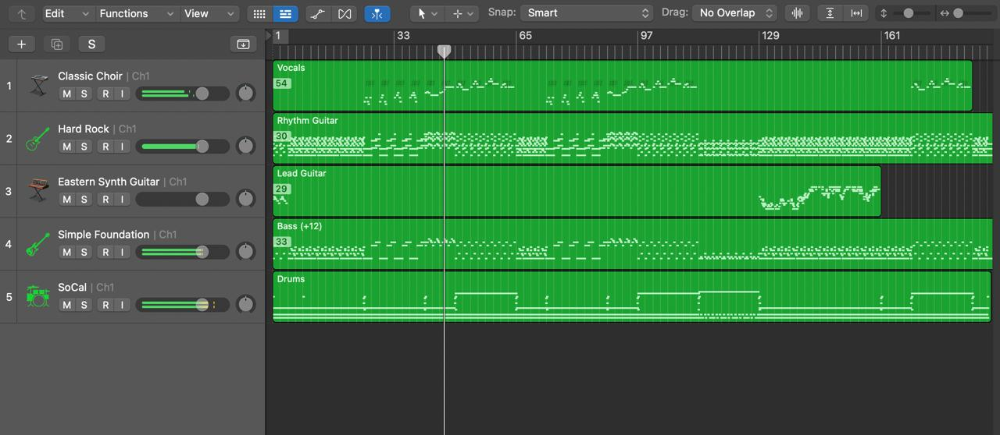

# Logic AI Composer

**English** · [Türkçe](docs/README.tr.md) · [Español](docs/README.es.md) · [Deutsch](docs/README.de.md) · [Français](docs/README.fr.md) · [Português](docs/README.pt-BR.md) · [日本語](docs/README.ja.md) · [한국어](docs/README.ko.md) · [简体中文](docs/README.zh-CN.md)

Describe the music you want, and Claude writes the MIDI: every note of every
part, in your style, key and chords. Each part lands on its own track in Logic
Pro, so it plays **your own software instruments** (Alchemy, Kontakt, Serum, …)
and stays fully editable.



> "Lo-fi, 84 BPM, Am7 – Fmaj7 – C – G, piano, bass and drums, 8 bars"
> "A 3-minute original synthwave song"
> "Turn ~/Desktop/mysong.wav into MIDI" · "Make a jazz cover of it"

It runs with your own Claude account (Claude Code or Claude Desktop). Audio work
runs locally on your Mac. There are no servers and no extra fees.

## What it does

- **Compose**: Claude writes original parts or whole songs of any length, in the
  style, key, tempo and instruments you ask for.
- **Audio → MIDI**: splits a song into stems (vocals, bass, guitar, piano, other,
  drums) and transcribes each to its own MIDI track.
- **Covers**: keeps the melody and harmony of your song and re-arranges it in a new style.
- **Lyrics and vocals**: Claude writes original lyrics in any language and style (or uses yours) and a singable vocal melody, one syllable per note, plus a lyric sheet.
- **Master**: masters your Logic bounce for Spotify, Apple Music and YouTube
  (-14 LUFS, ≤ -1 dBTP, 24-bit WAV) and reports the loudness numbers.
- **Mix and Dolby Atmos guide**: Claude walks you through a starting mix and an
  Atmos (Spatial Audio) setup and ADM BWF export inside Logic.

## Install

Requires macOS, Logic Pro, Node.js 18+ and Claude Code or Claude Desktop.

```bash
git clone https://github.com/dodomovic/logic-ai-composer.git
cd logic-ai-composer && npm install
```

**Claude Code**

```bash
claude mcp add logic-ai-composer -- node /path/to/logic-ai-composer/src/server.js
```

Copy `skills/logic-composer` into `~/.claude/skills/` for the composing guide.

**Claude Desktop**: add this to `claude_desktop_config.json`:

```json
{ "mcpServers": { "logic-ai-composer": { "command": "node", "args": ["/path/to/logic-ai-composer/src/server.js"] } } }
```

**Audio features (optional)**: needs Python 3.11.

```bash
npm run setup-audio
```

This downloads about 2–3 GB of open-source tools and models to your Mac, not from
this repository. Set `LOGIC_AI_AUDIO_HOME` to install them elsewhere, for example
on an external disk.

Files are saved to `~/Music/Logic AI Composer` (set `LOGIC_AI_COMPOSER_DIR` to
change it). Set `LOGIC_APP` if your Logic Pro app has a different name.

## Using your own songs

Don't upload the song as a chat attachment: attachments go to Claude's servers and
the tool can't reach them. Drag the file from Finder into the Claude Code prompt
(it pastes the path), or type where it is, e.g. "Desktop/mysong.wav". The audio
never leaves your Mac.

Separation uses the best-quality models, so it takes a while. How long depends on
your Mac: on an Apple Silicon Mac, expect several minutes up to roughly 10 minutes
for a 4-minute song; older or Intel Macs take longer.

## Tools

| Tool | What it does |
|---|---|
| `chord_notes` | Chord symbols → notes (`Am7`, `Fmaj7`, `C/E`, `G7sus4`, …) |
| `scale_notes` | Notes of a scale (major, minor, modes, pentatonic, blues, hicaz) |
| `write_midi` | Writes the parts to a multi-track `.mid` and opens it in Logic Pro; optional drum engine (trance, melodic techno, dance/house) and controller automation |
| `audio_to_midi` | Song → stems → multi-track MIDI, plus tempo, key and all notes for covers |
| `master_audio` | Masters a bounced mix for streaming, with a before/after loudness report |

Under the hood:
- vocals, drums and bass are split with Demucs `htdemucs_ft`, guitar and piano with `htdemucs_6s`;
- pitched parts are transcribed with Spotify's Basic Pitch, drums with per-band onset detection;
- mastering uses Spotify's Pedalboard, and loudness is measured with pyloudnorm (ITU-R BS.1770).

## Cost

Audio separation, transcription and mastering run on your Mac and use no Claude
tokens. Claude's tokens are spent only when it reads or writes notes. Roughly:

- reading a transcription: 15–50k tokens;
- a cover or a new 3-minute song: 40–80k tokens.

With a Claude subscription this costs nothing extra; it counts toward your plan's
usage limits.

## Originality and copyright

When Claude writes a song, it composes new notes from the style you describe; it
does not look up or copy recordings, and it won't write out a copyrighted melody
from memory. Styles, tempos and common chord progressions aren't protected;
recognisable melodies are.

You can transcribe or cover any audio file you have on your Mac, for example to
study or practise a song. What you do with the result is up to you, as with any
DAW or notation tool. Releasing a cover or sharing a transcription of someone
else's song may need the rights holder's licence.

## License

MIT. Logic Pro and Dolby Atmos are trademarks of their owners (Apple Inc., Dolby
Laboratories). This project is not affiliated with or endorsed by them. Models
downloaded by `setup-audio` keep their own licenses.

## Fully automatic audio (REAPER)

With [REAPER](https://www.reaper.fm) installed, `render_audio` turns the MIDI into a finished song with no
manual steps: each part is played by your own instruments, levels are set per role, REAPER renders
headlessly, and the result is mastered for streaming and saved as WAV and MP3.

One-time setup: create `~/Documents/LogicAIComposer/LAC Template.RPP` with one track per role
(`Drums`, `Sub Bass`, `Bass`, `Lead`, `Pluck`, `Arp`, `Pad`, `Strings`, `Choir`, `Piano`), each with the
instrument and sound you like (for example EZdrummer, Analog Lab, Nexus, Serum), and any master FX.
Set `LAC_REAPER_TEMPLATE` to use another path.
